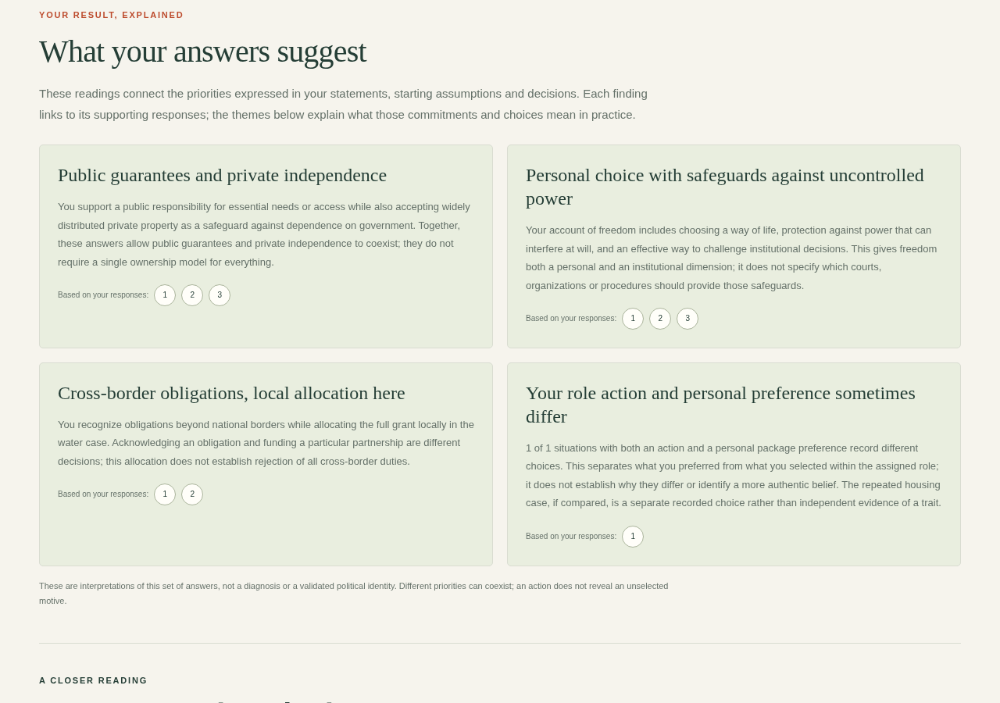
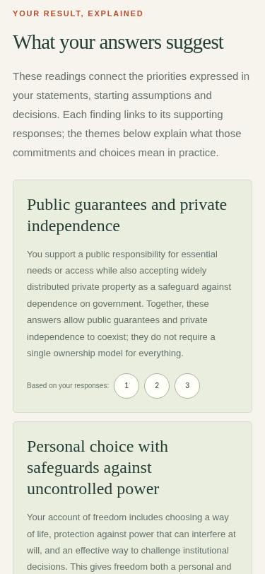

# Result interpretation preview — 0.4.3

These screenshots show the completed result screen using synthetic test answers, not a real participant's responses. Personal reports vary with the answers provided. This example deliberately agrees with statements expressing different priorities and records a role action that differs from the optional personal preference.

The opening cards explain combinations of answers and link to the supporting records. Below them, seven themes explain the priorities, assumptions, and consequences of chosen actions; the original answers are available in expandable sections. These authored interpretations are exploratory and do not assign a validated political identity.

## Desktop

## Mobile

Captured from the packaged 0.4.3 application on 26 October 2026. The screenshots are previews, not evidence that this release has been deployed to the public site.
